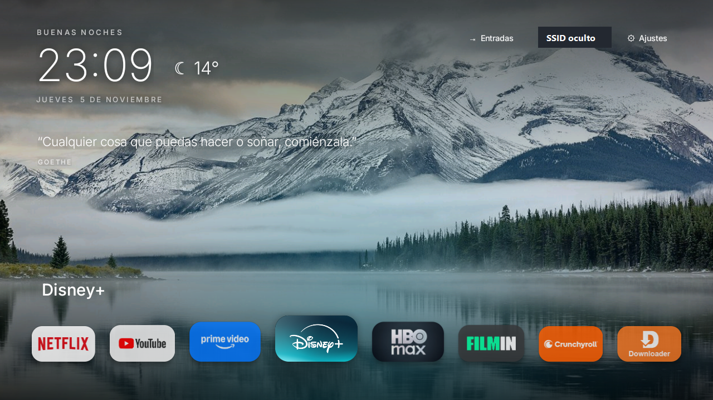
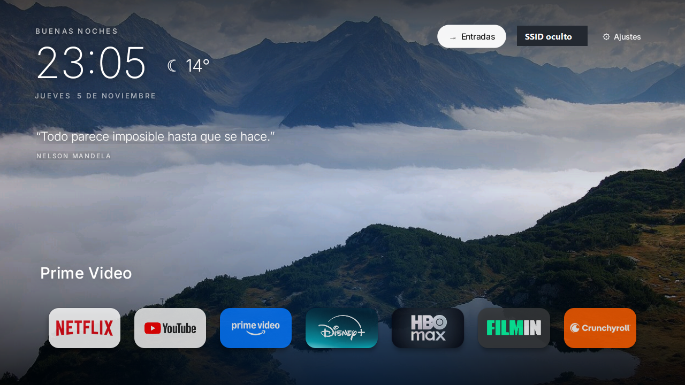
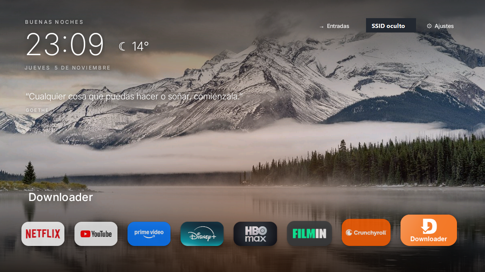

# freeTV_TCL

Herramienta comunitaria para Windows que ayuda a configurar y optimizar algunos televisores TCL con Android TV mediante ADB inalámbrico. Incluye un menú en español para instalar un launcher alternativo, ajustar animaciones, gestionar aplicaciones y crear un diagnóstico.

> Proyecto independiente y no oficial. TCL y Android TV son marcas de sus respectivos propietarios. La compatibilidad depende del modelo y de la versión de Android TV; no se garantiza para todos los televisores TCL ni para modelos con Roku TV.

## Capturas

El nombre de la red doméstica se ocultó en ambas imágenes.

**Pantalla principal del launcher**

**Aplicaciones en el launcher**

**Vista de inicio, fondo y accesos**

## Funciones

- Conectar y vincular el televisor por ADB inalámbrico.
- Instalar el launcher y configurar el salvapantallas.
- Ajustar animaciones para una interfaz más ágil.
- Desactivar o quitar para el usuario actual paquetes seleccionados.
- Restaurar el launcher de Google y los ajustes guardados.
- Crear un informe local para ayudar a diagnosticar problemas.

## Requisitos

- Windows 10 u 11 y Windows PowerShell.
- Televisor TCL con Android TV y la opción **Depuración inalámbrica** disponible.
- PC y televisor conectados a la misma red local.
- Conexión a Internet para descargar Android Platform Tools de Google y los fondos de Wikimedia Commons.

No requiere root ni desbloquear el bootloader.

## Instalación y uso

1. Descarga `freeTV_TCL.zip` desde este repositorio y extrae todos sus archivos.
2. En el televisor, activa **Opciones para desarrolladores > Depuración inalámbrica**.
3. Ejecuta `INICIAR_freeTV_TCL.bat` y sigue las indicaciones para vincular y conectar el televisor.
4. Elige una opción del menú. Para volver atrás, usa **Deshacer cambios** desde el mismo PC donde se guardó la copia.

Mantén el APK junto al script al extraer el ZIP; el lanzador necesita ambos archivos.

## Importante antes de aplicar cambios

Las opciones de configuración y eliminación pueden desactivar o quitar aplicaciones del usuario actual, incluidas funciones del fabricante, recomendaciones, asistente o componentes de actualización. Revisa los cambios antes de continuar. La opción **Deshacer cambios** usa una copia local guardada en `%LOCALAPPDATA%\TVCasaJulia\estado.json`; conserva esa carpeta y usa el mismo PC para restaurar el estado anterior. Una restauración completa no está garantizada para todos los modelos.

El programa guarda localmente la dirección de la tele, el estado previo, los registros y los diagnósticos en `%LOCALAPPDATA%\TVCasaJulia`. No envía esos informes a GitHub ni a un servidor del proyecto. La descarga de herramientas y fondos sí contacta a Google y Wikimedia Commons.

## Palabras clave

TCL Android TV, optimizar tele TCL lenta, ADB inalámbrico para Android TV, configurar TCL desde Windows, launcher alternativo para Android TV, salvapantallas Android TV y diagnóstico ADB.

El desarrollador no se hace cargo de los depesperfectos que pueda ocasionar el software.
